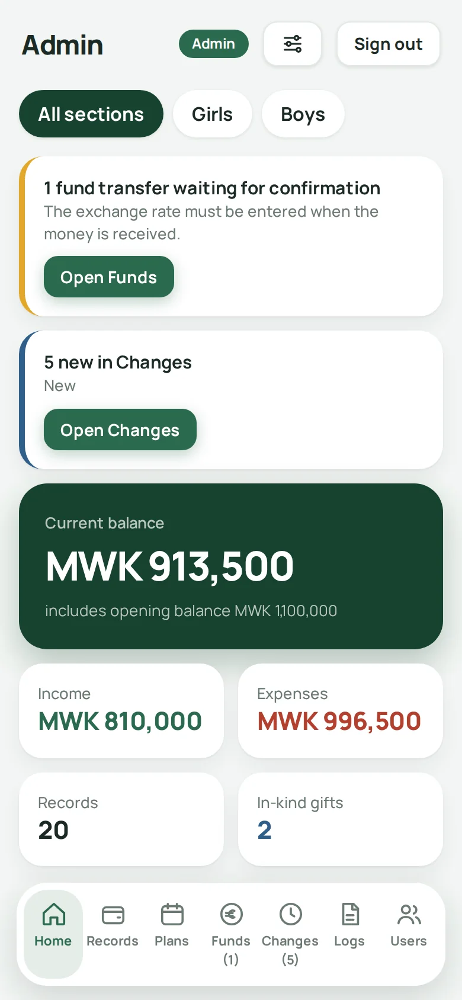
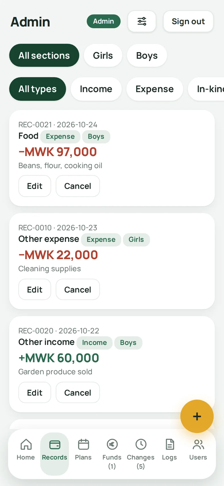
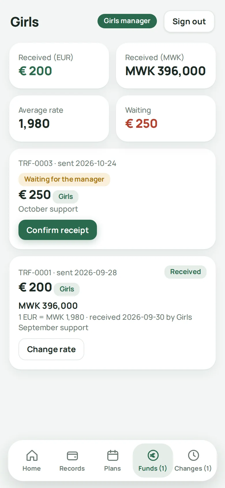
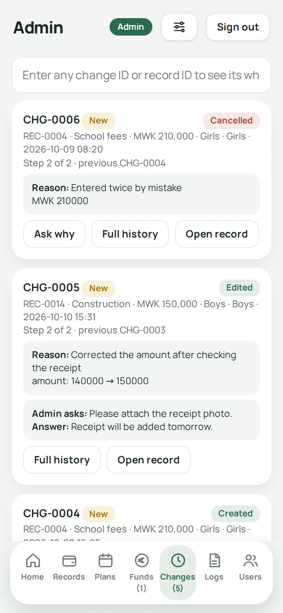
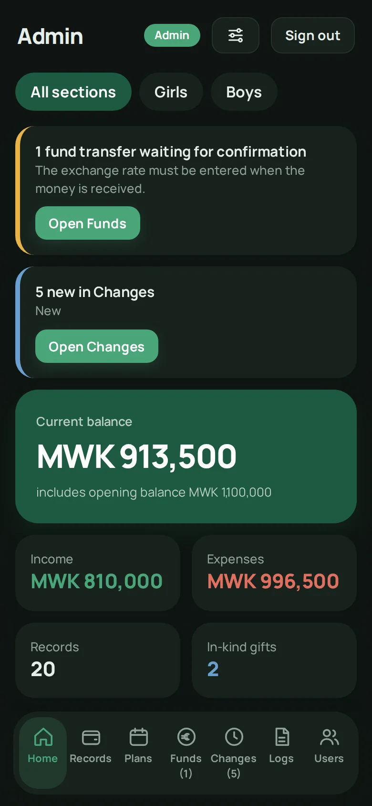

# Orphanage Manager

Orphanage Manager is a modern, fast, and centralized web application developed to digitalize orphanage operations, manage donations, track children's activities, and handle day-to-day administration.

**[Download the latest release](https://github.com/celalcelikkaya/orphanage-manager/releases/latest/download/orphanage-manager-main.zip)** &nbsp;·&nbsp; [Release notes and all versions](https://github.com/celalcelikkaya/orphanage-manager/releases/latest)

## Features
- **Centralized Data Management:** Secure and fast data storage powered by Google Apps Script and Google Sheets.
- **Modern User Interface:** Responsive design built for both mobile and desktop, supporting dark mode.
- **Modular Architecture:** Clean separation of backend logic and frontend components.

## Screenshots

  
  
  
  
  

*Screenshots use sample data.*

---

## Default Login Credentials (After Setup)
When you run the initial setup, the system automatically creates default accounts with these credentials:
- **Admin:** `Admin` / Password: `admin123`
- **Girls Manager:** `Girls` / Password: `girls123`
- **Boys Manager:** `Boys` / Password: `boys123`

> **Important:** These passwords are only for your first login. Sign in as **Admin**, open the **Users** tab and tap **New password** for every account (the app generates the new password for you) before you share the web app link with anyone.

---

## Complete Installation & Deployment Guide

Follow these steps to set up and deploy the application from scratch.

**Get the files first:** [download the latest release](https://github.com/celalcelikkaya/orphanage-manager/releases/latest/download/orphanage-manager-main.zip) and unzip it. It contains the four files you need: `Code.gs`, `Index.html`, `App1.html` and `App2.html`. (You can also copy them from this repository.)

### Step 1: Create a Google Apps Script Project
1. Go to [Google Apps Script](https://script.google.com/).
2. Click on **New project** in the top-left corner.
3. Rename your project to **Orphanage Manager**.

### Step 2: Add the Backend Code (`Code.gs`)
1. Replace the default code inside the automatically created `Code.gs` file with the provided backend script (`Code.gs` from this repository).
2. Save the project (`Ctrl + S` or click the disk icon).

### Step 3: Add Frontend Files (`Index`, `App1`, `App2`)
The application dynamically loads frontend parts using `bootApp(i)`. You must create these files in the exact order:
1. Click the **[+] (Add a file)** button at the top of the file list and select **HTML**.
2. Name the file **`Index`** (the `.html` extension is added automatically) and paste the contents of `Index.html`. Save it.
3. Add another HTML file named **`App1`** and paste the contents of `App1.html`. Save it.
4. Add another HTML file named **`App2`** and paste the contents of `App2.html`. Save it.

### Step 4: Run the Initial Setup & Grant Google Drive Permissions
1. In the top function dropdown menu (next to the Run button), select the **`setup`** function.
2. Click **Run**.
3. **Google Permission / Authorization Process:**
   - A window will pop up stating **"Authorization Required"**.
   - Click **Review permissions** and select your Google account.
   - You will see a security warning (*"Google hasn't verified this app"*). Click on the small **"Advanced"** link at the bottom left.
   - Click on **"Go to Orphanage Manager (unsafe)"** (this is a standard warning for self-written scripts running on your own account).
   - Click **Allow** to grant permissions.
4. Once executed successfully, a Google Sheets database named **"Orphanage Manager Data"** and a folder named **"Orphanage Photos"** will be automatically created in your Google Drive.

### Step 5: Deploy as a Web Application
1. In the top-right corner of the Apps Script editor, click **Deploy** > **New deployment**.
2. Click the gear icon next to *Select type* and choose **Web app**.
3. Fill in the deployment details:
   - **Description:** Orphanage Manager v1
   - **Execute as:** Me (your email)
   - **Who has access:** **Anyone** (Required so managers can log in from mobile devices or external browsers).
4. Click **Deploy**.
5. Copy the generated **Web app URL** and open it in your browser to start using the system.
